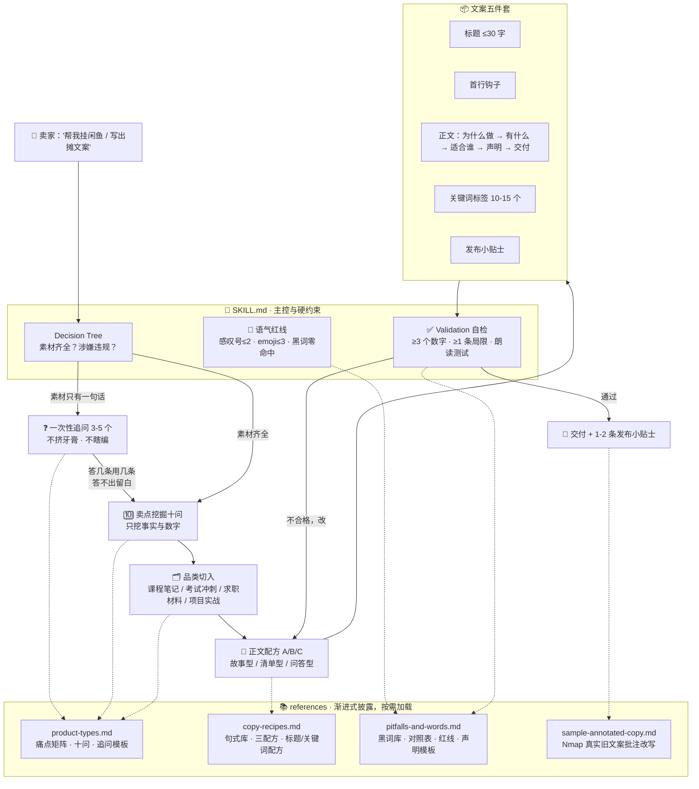

<div align="center">

# 🐟 xianyu-copywriting

**把「学生自产学习资料」写成同学之间的安利——真诚、不油腻、能出单的闲鱼文案技能**

*Sell like a classmate, not a storefront.* / 纯 Markdown 提示词工程 · 零代码 · 渐进式披露

[](SKILL.md)
[](SKILL.md)
[](SKILL.md)
[](https://www.goofish.com)

[快速开始](#-快速开始) · [设计支柱](#-三大设计支柱) · [架构总览](#-架构总览) · [核心机制](#-核心机制) · [适用范围](#-适用范围)

</div>

---

> ### 💭 同学之间的安利，不是商家的详情页
> 这是一个 DSH 技能（Skill）：当你说「帮我挂闲鱼 / 写出摊文案」，它会把你亲手整理的笔记、提纲、题解、模板，写成学长学姐在班群里安利资料的那种文案——真实、具体、可信。
> 没有喊麦促销，没有「超全」「绝绝子」「天花板」——**每个卖点都必须是一个可核实的事实，每次坦诚都必须落在字面上。**

---

## ✨ 三大设计支柱

|                                                    🎭 同学腔人设                                                     |                                                  📏 可检验的真诚                                                  |                                                     🛡️ 合规内建                                                     |
| :------------------------------------------------------------------------------------------------------------------: | :--------------------------------------------------------------------------------------------------------------: | :----------------------------------------------------------------------------------------------------------------: |
| 叙述者永远是资料作者本人（第一人称「我」），黑词库 + 商家腔→同学腔对照表把「宝子」「手慢无」「独家秘籍」式喊麦腔逐词拦截 | 真诚不是形容词而是硬指标：感叹号全文 ≤2、emoji ≤3、≥3 个具体数字、≥1 条主动局限，交付前必须过 6 项 Validation 自检 | 盗版转卖 / 代写代做 / 账号买卖触发即拒并给出话术；安全工具、真题回忆、模板类自带合规声明模板；素材不足宁可留白，绝不编造 |

## 🚀 功能全景

- 🏷️ **文案五件套** — 标题（≤30 字）+ 首行钩子 + 正文 + 关键词标签（10-15 个）+ 发布小贴士，一次交付直接可挂
- 🔟 **卖点挖掘十问** — 只挖数字、覆盖范围、踩坑记录、可复现性；十问答不出 6 个就回去追问，绝不硬写
- 🗂️ **四类痛点矩阵** — 课程笔记 / 考试冲刺 / 求职材料 / 项目实战，各配买家真实处境与开头场景锚点
- 📐 **三种正文配方** — 故事型 / 清单型（默认）/ 问答型，按素材类型自动选择；固定收尾三件：声明 → 交付行 → 同学感结尾
- 🚫 **五类黑词库** — 空洞形容 / 喊麦促销 / 自吹身份 / 油腻语气 / 平台限流词，出现即改
- 🗣️ **商家腔→同学腔对照表** — 7 组真实改写示范：「原价 99 现价 9.9」→「定价就是一顿早饭钱，图个整理费」
- ❓ **一次性追问模板** — 素材不足时一次问完 3-5 个关键信息，不挤牙膏；答不出的位置留白，不写「985 学霸」这类无法核实的话
- 📎 **真实样例锚定** — 一份 Nmap 笔记旧文案的逐项诊断与改写对照，所有配方都有出处，不凭空想象

## 🏗️ 架构总览



**技术构成**：`SKILL.md`（frontmatter 元数据 + 六步工作流 + 红线 + 自检清单）· 4 个渐进式披露参考文件 · 1 个 YAML Agent 镜像 —— 无任何运行时依赖

## 📦 文案五件套（标准输出）

| # | 产物 | 硬性要求 |
|---|------|---------|
| 1 | **标题** | ≤30 字，品类词开头 + 核心搜索词，最多一个竖线，不堆符号 |
| 2 | **首行钩子** | 一句话，用具体数字或场景勾住对应人群 |
| 3 | **正文** | 我为什么做（1-2 句）→ 里面有什么（清单化、带数字）→ 适合谁 → 小声明 → 交付说明 |
| 4 | **关键词标签** | 10-15 个买家真的会打的搜索词，`#` 格式放文末 |
| 5 | **发布小贴士** | 可选：价格锚点、擦亮时间、首图建议 |

## 🔬 核心机制

### 卖点挖掘十问（事实驱动，答不满不写）

覆盖什么 → 有多少（页数/条目数，数字是最好的卖点）→ 最难最值钱的部分 → 它怎么来的 → 做成过什么真事 → 买家第一步能干什么 → 需要什么基础 → **适合谁、不适合谁（各至少一条）** → 交付方式 → 合规点。
十问答不出 6 个时禁止硬写——这条阈值把「编造卖点」从源头堵死。

### 双向坦诚（可信度来自局限性）

> 「先说清楚：这不是什么神仙资料，就是一个普通学生把实验课内容整理扎实了，胜在每一步都能照着跑通。」

每一篇文案必须写「不适合谁」，并主动交代至少一条局限（页数不多、只覆盖某章、需要基础）。这在卖货文案里反直觉，但正是学生卖家相对商家最大的差异化优势——反向坦诚型开头是五种开头句式之一。

### 商家腔 → 同学腔（改写原则）

| 商家腔 | 同学腔 |
|--------|--------|
| 本资料内容超全，涵盖所有考点 | 全套上下两份共 15 页，实验课要考的基本都在里面 |
| 原价 99 现价 9.9 | 定价就是一顿早饭钱，图个整理费 |
| 售后无忧，不满意包退 | 有看不懂的地方直接问我，看到就回 |

改写原则一句话：**把「形容资源好」改成「描述资源里具体有什么 + 我和它的真实关系」。** 收尾的「看完有不明白的可以问我，看到就回」是同学感的关键——商家不会说这句。

### 平台红线（触发即拒，话术内置）

- ⛔ 盗版资源转卖：网课录屏、付费题库、电子书扫描件
- ⛔ 代写代做：作业代写、报告代做、考试代考
- ⛔ 账号类：学生认证账号、会员账号、共享账号
- ⛔ 站外引流词（+V、威信、私聊看主页）：出现即删，闲鱼会限流

内置拒绝话术并给出替代方案（「如果是你自己整理的同主题笔记，我可以帮你写那份的文案」）；安全工具、真题回忆、模板类自动嵌入对应合规声明模板，且压缩成一句正常陈述，不写成恐吓体。

## 📂 项目结构

```
xianyu-copywriting/
├── 📄 SKILL.md                      # 主入口：元数据 + 六步工作流 + 语气红线 + Validation 自检清单
├── 🤖 agents/
│   └── openai.yaml                  # Agent 元数据镜像（name + description），兼容独立 Agent 挂载
└── 📚 references/                   # 渐进式披露参考库，工作流走到对应步骤才加载
    ├── product-types.md             # 四类资料痛点矩阵 + 卖点挖掘十问 + 一次性追问模板
    ├── copy-recipes.md              # 开头句式五型 + 正文三配方 + 标题/关键词/交付行配方
    ├── pitfalls-and-words.md        # 五类黑词库 + 商家腔→同学腔对照表 + 平台红线 + 合规声明模板
    └── sample-annotated-copy.md     # 真实锚点：Nmap 旧文案逐项诊断与改写对照
```

> 设计模式：**渐进式披露（Progressive Disclosure）**——SKILL.md 只放骨架（工作流、红线、自检），细节按工作流步骤按需加载，省上下文 token 又不丢细节。逐条规则的深度导读见 [SKILL.md](SKILL.md)。

<details>
<summary><b>📎 改写示范节选</b>（来自真实 Nmap 笔记旧文案，点击展开）</summary>

> **标题**：Nmap 网络扫描实战笔记｜主机发现 端口扫描 抓包分析 可复现
>
> **首行钩子**：15 页 136 条，我自己网安实验课一篇篇敲出来的 Nmap 笔记，每一步都跑通过才敢发。
>
> **正文**：上学期做网络扫描实验，讲义只给命令不给原理，报文抓出来也看不懂，我就边做边把过程记了下来，前前后后整理成上下两份共 15 页。……
>
> **结尾**：拍下后发电子版双 PDF，不是实物哦～秒发。看完有不懂的可以问我，看到就回。

原文案的问题（90+ 字超长首段、8 组清单过载、恐吓体声明、关键词 21 个变体重复、全文零第一人称）与逐项改写方向，见 [references/sample-annotated-copy.md](references/sample-annotated-copy.md)。

</details>

## 🚀 快速开始

### 0️⃣ 环境要求

| 组件 | 要求 |
|------|------|
| 宿主环境 | DeepSeek Harness（DSH），或任何支持 Agent Skills 范式（SKILL.md）的 Agent 宿主 |
| 磁盘空间 | < 50 KB |
| 运行时依赖 | 无（纯 Markdown / YAML） |

### 1️⃣ 安装

```powershell
# Windows（DSH 用户技能目录）
git clone https://github.com/<your-name>/xianyu-copywriting.git "$env:USERPROFILE\.dsh\skills\xianyu-copywriting"
```

```bash
# Linux / macOS
git clone https://github.com/<your-name>/xianyu-copywriting.git ~/.dsh/skills/xianyu-copywriting
```

> 也可以 Download ZIP 后手动放进技能目录。放置后重启会话（或刷新技能列表）即可被识别。

### 2️⃣ 触发

| 方式 | 操作 |
|------|------|
| 自然语言 | 说「帮我挂闲鱼」「写出摊文案」「改闲鱼标题」，且商品是自产学习资料时自动加载 |
| 手动调用 | 在输入框旁技能选择器点选，或消息里带 `/xianyu-copywriting` |

### 3️⃣ 准备素材（有则更快，缺了技能会一次问完）

- [ ] 覆盖范围 + 页数 / 条目数（数字是最好的卖点）
- [ ] 它怎么来的（考试复习 / 实验课 / 实习总结）
- [ ] 真实效果背书（分数 / 成绩 / 拿到面试）
- [ ] 买家拿到后怎么用（直接交 / 照着学 / 填模板）
- [ ] 交付格式（PDF / Word）与要声明的合规点

### 4️⃣ 收货与迭代

交付为五件套格式。你可以指定正文配方（A 故事型 / B 清单型 / C 问答型）、要求更口语或更收敛、只改标题或只做黑词诊断——把旧文案发给它，它会先按黑词库诊断油腻点、保留其中的真实事实，再重构。

## 🎯 适用范围

| ✅ 处理 | ❌ 拒绝 |
|---------|---------|
| 自产课程笔记（Nmap、计网、OS、高数…） | 实物二手闲置 |
| 考试冲刺资料（四六级、期末、考研提纲） | 盗版资源转卖（网课录屏、付费题库、电子书扫描件） |
| 求职材料（简历模板、面经、八股整理） | 代写代做（作业、报告、考试） |
| 项目实战文档（课设、报告、部署手册） | 账号类商品（认证号、会员号、共享号） |

## 💡 可扩展方向

- [x] 四类品类痛点矩阵与卖点挖掘十问
- [x] 五类黑词库 + 商家腔→同学腔对照表
- [x] 真实旧文案批注改写样例（Nmap 笔记）
- [ ] 更多真实改写样例（简历模板 / 面经 / 考研冲刺）
- [ ] 成交效果回收（用真实浏览 / 成交数据反哺配方）

---

<div align="center">

🤝 欢迎贡献：Fork → 新建分支 → 提交 PR，补充你的品类样例与黑词

**如果这套文案方法论帮到了你，点个 Star ⭐ 让更多同学看到**

</div>
