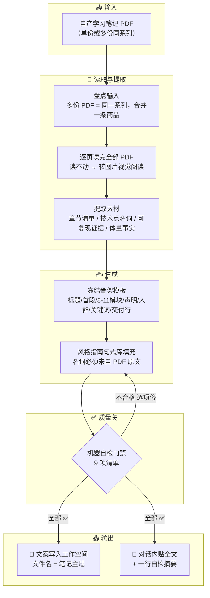

<div align="center">

# 🐟 xianyu-copywriting

**把自产学习笔记 PDF 写成闲鱼高密度商品文案的 AI Skill**

*Turn your study notes into marketplace listings that sell* / Markdown Prompt · Few-Shot 蒸馏 · 机器自检门禁

[](./xianyu-copywriting/SKILL.md)
[](./xianyu-copywriting/SKILL.md)
[](./xianyu-copywriting/references/golden-examples.md)
[](./LICENSE)

[这是什么](#-这是什么) · [核心机制](#-核心机制) · [工作流](#️-工作流) · [快速开始](#-快速开始) · [项目结构](#-项目结构)

</div>

---

## 📌 这是什么

**xianyu-copywriting** 是一个 AI Agent Skill（技能包）：你把自己整理的学习笔记 PDF（技术笔记、复习提纲、题解、实验手册）丢给它，它产出一条与黄金案例同等密度和腔调的闲鱼商品文案——约 100 行、8-11 个编号硬技能模块、关键词矩阵、合规声明、交付行，一条文案直接撑起一个完整商品详情页。

> **它不生成万能模板文案，只复刻经过市场验证的黄金案例。**
> 骨架冻结、事实反推、自检门禁——三条铁律保证每次产出都像同一本书的同一页。

它的与众不同之处在于：文案结构不是模型自由发挥，而是从 **5 篇真实成交风格案例**（Claude Code / Docker / MCP / LangChain / Maven）中蒸馏出的「冻结骨架模板」——段落顺序、各段句式全部锁定，只有内容填充变化。AI 写闲鱼文案最常见的两个毛病——密度漂移（越写越水）和事实编造（"985 学霸整理"查无依据）——在这里分别被**骨架冻结**和**事实反推**两条铁律挡住。

---

## ✨ 核心机制

| 机制 | 落点 | 解决的问题 |
|---|---|---|
| 📖 **完整阅读铁律** | [SKILL.md](./xianyu-copywriting/SKILL.md) 铁律 1 | PDF 漏读 → 卖点静默丢失。反面教材直接写进技能：*"豆包只阅读了前 20%"*。交付前必须核对**已读页数 = 总页数**，逐页读、抽样核对章节目录与正文对得上 |
| 🧊 **冻结骨架模板** | SKILL.md「冻结骨架模板」 | 生成密度/腔调漂移。段落顺序、句式严格按模板，禁止增删段落、禁止调整顺序、禁止把声明改成温和话——黄金案例的密度就是卖点 |
| 🔍 **事实反推规则** | SKILL.md 铁律 3 | AI 编造卖点。数字类表述（页数/字数/章节数）从 PDF 实测反推；「全程带截图」必须抽验 PDF 里确实有截图才写；查无依据的背书（状元整理、985 学霸）不写 |
| ✅ **机器自检门禁** | SKILL.md「自检门禁」 | 生成质量不可验证。9 项清单逐项核对（骨架完整 / 模块数 8-11 / 名词可溯源抽查 5 个 / 关键词 15-20 …），全部 ✅ 才交付，末尾附一行自检摘要 |
| 🛟 **兜底规则** | [golden-style-guide.md §九](./xianyu-copywriting/references/golden-style-guide.md) | 扫描版/图片版 PDF 卡死或漏读。文本抽不出来 → 自动转图片逐页视觉阅读；个别页读不出 → 明示「第 X-Y 页未能读取」并标注推断章节，**绝不静默跳过** |
| 🚫 **盗版红线** | SKILL.md 铁律 4 | 合规风险前置拦截。他人付费资源转卖（盗版网课/题库/电子书）、代写代做 → 直接拒绝出文案并说明平台风险 |

另有三个隐性设计：**关键词三类配方**（精确词 + 场景词 + 人群词，15-20 个，见风格指南 §六）保证闲鱼搜索曝光；**声明段贴合品类**（Docker 笔记禁「搭建非法服务」、LangChain 笔记禁「违规 AI 应用」）拒绝万能模板套话；**多 PDF 自动合并**（同批 PDF 默认同系列，合一条商品一份文案，不询问）减少交互摩擦。

---

## ⚙️ 工作流



文案骨架一目了然——每一段都被冻结，AI 只负责把 PDF 的真实内容填进正确的位置：

```text
《主标题》
｜副标题：核心技术点罗列，以「完整可复现」类承诺收尾
首段（个人整理叙事：身份 + 来源 + 覆盖范围 + 过程承诺 + 零基础承诺）
笔记的硬核精华兼实战能用的硬技能：
1.【模块名・一句话点题】…（共 8-11 个模块，每模块 5-8 条子弹）
重要声明！！！（按品类定制合规声明，保留原味格式）
适合群体：（4-5 条画像 + 痛点）
关键词：#词1 #词2 …（15-20 个，三类混合）
拍下后发完整版PDF，不是实物哦～秒发，无延迟直接获取！
```

---

## 🚀 快速开始

### 0️⃣ 环境要求

| 组件 | 要求 |
|---|---|
| 宿主 | 任何支持 Skill 机制的 AI Agent 宿主（如 DeepSeek Harness） |
| 技能目录 | `<skills>/xianyu-copywriting/`，内含 `SKILL.md` 与 `references/` |
| 输入文件 | 你自己整理的学习笔记 PDF（必须是自产，见下方合规声明） |

### 1️⃣ 安装技能

把 `xianyu-copywriting/` 整个文件夹放入宿主的技能目录。以 DeepSeek Harness 为例：

```powershell
# 复制技能包到用户技能目录
Copy-Item -Recurse .\xianyu-copywriting "$env:USERPROFILE\.dsh\skills\"
```

### 2️⃣ 触发技能

对 Agent 说任意一句触发语，或提供 PDF 时它自动命中：

> 「帮我挂闲鱼」/「写闲鱼文案」/「出摊文案」/「上架文案」/「生成闲鱼商品文案」

### 3️⃣ 交付素材

把你的学习笔记 PDF 放入工作空间（或直接告知路径）。多份同系列 PDF 直接一起丢进去——技能会自动合并为一条商品，不额外询问。

### 4️⃣ 收货

技能跑完自检门禁后，你会得到：

- 工作空间根目录的文案文件（如 `ClaudeCode-闲鱼文案.md`）
- 对话内贴出的全文（方便当场改）
- 一行自检摘要：`✅ 自检：骨架完整｜9模块｜关键词18｜已读42/42页`

---

## 📁 项目结构

```text
xianyu-copywriting/
├── 📄 1.txt ~ 5.txt                     # 五篇黄金案例原始全文（蒸馏原料）
│                                        #   1《Claude Code》 2《Docker》 3《MCP》 4《LangChain》 5《Maven》
├── 📦 xianyu-copywriting/               # 技能包本体
│   ├── 🧠 SKILL.md                      # 技能主文件：铁律 / 工作流 / 冻结骨架 / 自检门禁
│   └── 📚 references/
│       ├── 📏 golden-style-guide.md     # 五案例蒸馏：句式库 / 模块写法 / 声明模板 / 关键词配方 / 兜底规则
│       └── 📖 golden-examples.md        # 完整 few-shot 范本（生成前必须通读找手感）
├── 📝 README.md                         # 本文件
├── 🪪 Description.md                    # 中英双版项目名片（GitHub About 可直接粘贴）
└── ⚖️ LICENSE                           # MIT License
```

**三层设计的数据流向**：`1-5.txt` 是蒸馏原料 → `golden-style-guide.md` 蒸馏出句式与规则 → `SKILL.md` 把规则装配成带铁律和门禁的可执行技能。改风格时先改风格指南，改流程与质量约束时改 SKILL.md，两层职责不混。

> 📖 逐文件深度导读暂未生成，如需要请运行 Code Explain Expert 技能生成 ZHIDAO.md。

<details>
<summary><b>❓ 为什么案例原文要以 txt 形式保留在仓库里</b>（点击展开）</summary>

`references/golden-examples.md` 只收录了案例 3（多 PDF 合并场景）完整原文与案例 2（单 PDF 场景）骨架摘录。五篇案例的原始全文保留在工作空间根目录的 `1-5.txt`，供生成时回读对照。案例文件中出现的「当前文件内容过长，豆包只阅读了前 X%」是工具残渣，蒸馏与产出时一律剔除，绝不出现在文案里——这条规则也写进了风格指南 §十。

</details>

---

## ⚖️ 合规声明

本技能**只服务于自产学习资料的合规变现**，并在铁律层面拒绝了三类商品：

- ❌ 他人付费资源转卖（盗版网课、题库、电子书扫描件）
- ❌ 代写代做服务
- ❌ 查无依据的虚假背书（「状元整理」「985 学霸」）

声明段按笔记品类定制违规行为清单（如 Nmap 笔记禁「未授权扫描」、Docker 笔记禁「搭建非法服务」），且保留「重要声明！！！」原味格式——合规本身就是文案的一部分。

---

<div align="center">

**如果这个 Skill 帮你把笔记变成了收入，欢迎点一个 ⭐**

Fork → Branch → Pull Request 欢迎贡献新案例与句式 | 基于 [MIT License](./LICENSE) 开源

</div>
